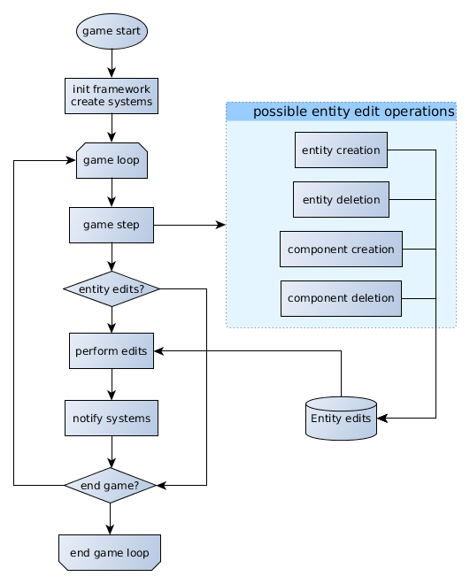
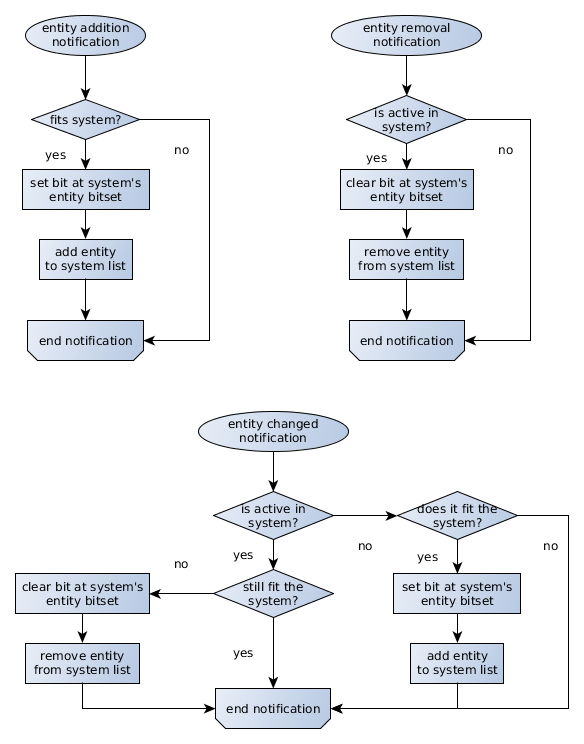
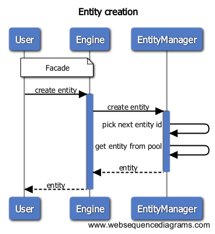
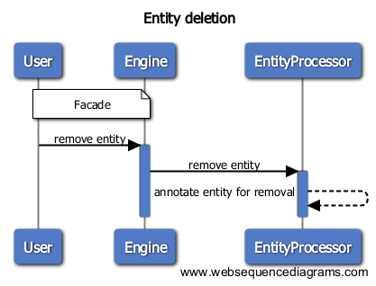
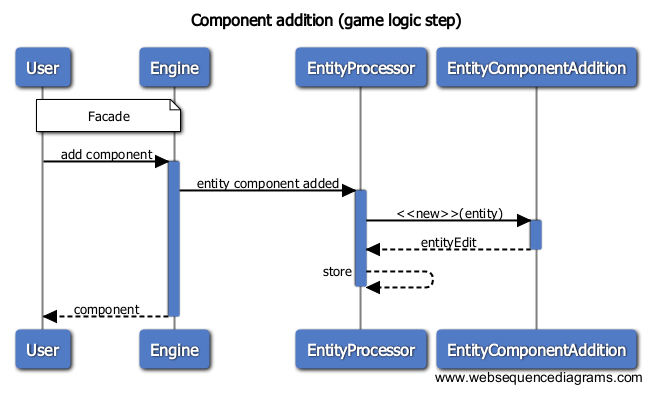
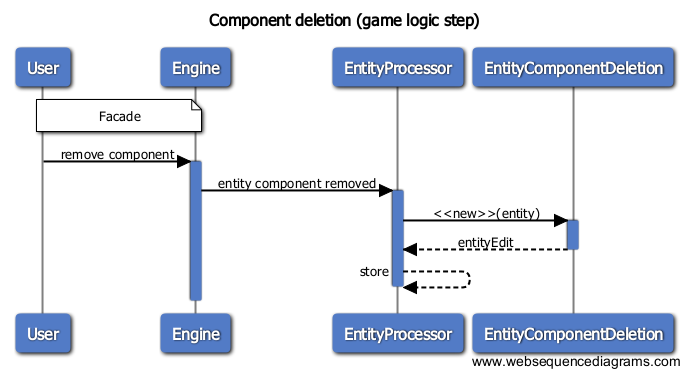
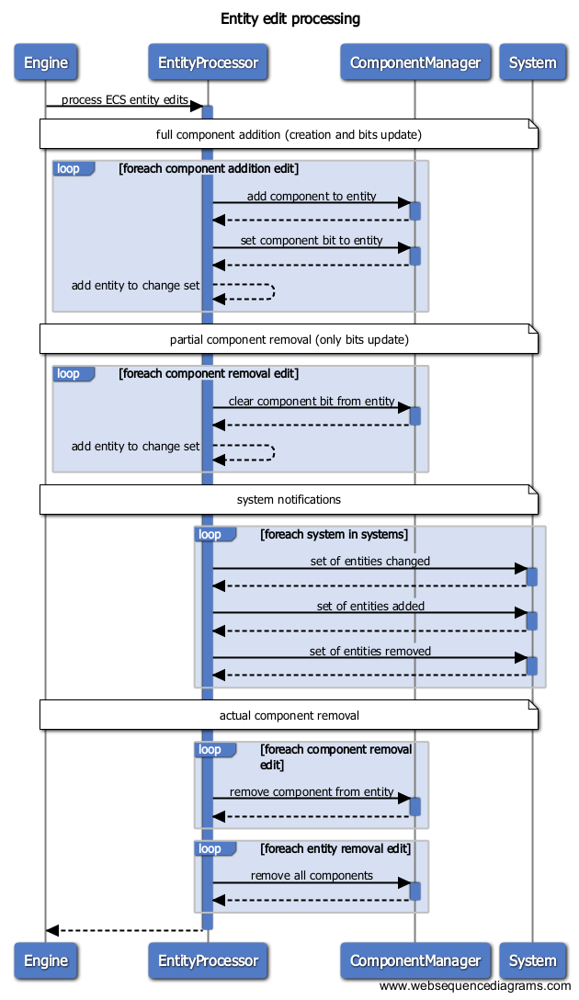

# secs specs

## Table of Contents

1. [Disclaimer](#1-disclaimer)
2. [Entity Component Systems](#2-entity-component-systems)
3. [Goals](#3-goals)
4. [Non-goals](#4-non-goals)
5. [Framework detail](#5-framework-detail)
    1. [Life cycle](#51-life-cycle)
    2. [System notification](#52-system-notification)
    3. [Entity operations](#53-entity-operations)
    4. [Entity handles](#54-entity-handles)
    5. [Component storage](#55-component-storage)

---

## 1. Disclaimer

**This document is in alpha stage and will constantly evolve during development.** The software used for the creation of the diagrams are **yEd** and **websequencediagrams.com**.

The diagrams describe the original design. Where the text and a diagram disagree, the text describes the current behaviour (the main difference: component flags are now updated immediately, see [5.3](#53-entity-operations)).

## 2. Entity Component Systems

#### What is an ECS?

I am not going to explain ECS in detail, but just mention each essential part for completeness.

* **Entity**. Every interactive element in a game can be an entity (i.e.: spikes, player, bullet, zombie pig).
* **Components**. Data belonging an entity (i.e.: health, color, animation, stats, weapon).
* **System**. Performs logic over components (i.e.: movement, shooting, dying, rendering, physics).

#### Why another one?

Well, there are a lot of ECS out there like ashley and artemis for java, and entityx for C++. Why to create a new one then? I've been somehow obsessed with this approach of handling logic in a game, but most of the time was wasted on studying others, reading and making experimental implementations, sometimes even using them in actual games. Because of this, I would like to take a more serious project and make one for C++, just for fun.

## 3. Goals

* **Usability** in real games.
* **Comprehensive design**.
* **Simplicity**, but not simpler than needed.
* Good **compromise** between last two points.
* **Reasonable performance**. No avoidable work on the per-frame path: packed component storage, no allocations when matching entities against systems, and benchmarks (`src/benchmarks`) to keep it honest.
* **Safety by default**. Misuse (stale entity handles, reading a component the entity doesn't have) is caught by asserts in Debug builds instead of silently corrupting data.

## 4. Non-goals

* **Being the fastest**. Performance matters (see goals), but the design won't be bent to compete with frameworks built around archetypes and multithreaded scheduling, such as EnTT or flecs.
* **Generality**. Meaning that the design will provide simple functionality without trying to cover all possible cases. An example of a very generic framework is artemis-odb, where a lot of use cases for types of systems (for example) are provided.
* **Thread safety**. An `Engine` and everything it owns is meant to be used from a single thread.

## 5. Framework detail

Note that I will use framework instead of system when referring to the ECS framework in order to avoid confusion between the ECS and the systems that process game logic within the framework.

### 5.1. Life cycle

Systems are usually created and inserted at start, but they can also be added later: a system added to a running engine is immediately offered every existing entity. Then, in the game loop, these systems perform the game logic.

Each call to `Engine::Step` does two things:

1. **Apply changes**: notify systems about every entity operation requested since the last step (see [5.3](#53-entity-operations)).
2. **Run systems**: call each enabled system, in execution-priority order.

Entity operations can be requested at any time, including from inside systems. Their effect on component data and flags is immediate, but systems only learn about them in the next apply-changes phase. This means the set of entities a system processes never changes while systems are running.

### 5.2. System notification

Systems have a bitset to quickly query which entities are present in the system and which are not. Each system also keeps track of the entities it processes. Systems are notified about the following operations:

* **Entity addition**: if the system accepts the entity (it has every component the system needs), the system marks it as active in the entity bitset, adds it to the processing list and calls `OnEntityAdded`.

* **Entity removal**: the system checks if the entity is marked as active. If it was, the system marks it as inactive, removes it from the processing list and calls `OnEntityRemoved`. The entity's components are still readable at this point, so the system can clean up (for example, remove a body from the physics world).

* **Entity changed**: if the entity was already in the system, the system checks if it still fits. If the entity does not fit the system, the system removes it. If the entity was not present in the system, the system checks if the entity fits the system. If so, the system adds the entity to its active entity list.

Matching an entity against a system is a subset test between the system's needed-components bitset and the entity's component bitset. It doesn't allocate.

The following flowchart resembles this logic:

### 5.3. Entity operations

So the available entity operations are the following:

* Create an entity
* Delete an entity
* Add component to an entity
* Remove component from an entity

During the game step, entity operations take effect on the data right away but are **annotated** for systems. Systems are only notified at the next apply-changes phase, avoiding bugs that depend on the order in which systems run. Also, since notifications are batched, systems are notified once per entity instead of once per component added.

An example to illustrate this is a shooting system whose purpose is to spawn bullets. This system would trigger a bullet spawn when an entity sets a flag `wantShoot` in a hypothetical `ShootComponent`. The bullet entity is created and its components are added right away, but no system processes the bullet until the next step. It will be like the bullet didn't even exist for the rest of this frame.

#### Entity creation

When an entity is created, a free ID from a pool is attached to it (see [5.4](#54-entity-handles)). The operation is annotated so that we can notify systems later.

#### Entity deletion

When an entity is removed, the operation is just annotated. The entity stays alive, and its components readable, until the apply-changes phase. This is because systems may need to perform some operations on these entities on removal. As an example, a PhysicSystem might want to remove the body from the physics world.

After systems have been notified, all of the entity's components are freed (their destructors run, releasing any resources they hold), the entity is removed from every tag, and its ID goes back to the pool.

Removing an entity that is already pending removal, or that is no longer alive, does nothing.

#### Component addition to entity

When a component is added to an entity, the component is allocated and passed back to the user, so that the user can modify it. The entity's component bit is set right away, so `HasComponent` returns true immediately. Only the system notification is delayed to the apply-changes phase.

Adding a component the entity already has returns the existing component unchanged.

#### Component deletion from entity

When a component is removed from an entity, its bit is cleared right away, so `HasComponent` returns false immediately. The component data stays readable until systems have been notified in the apply-changes phase, so that systems losing the entity can still read it. It is freed afterwards, unless the component was added back in the meantime.

Removing a component the entity doesn't have does nothing.

#### Entity processor

This is a key step, since here we complete operations partially done in the systems loop and notify systems. A set of **changed** entities is created and filled with the entities that had a component added or removed. Entities created in this batch are left out of it, since they are announced as added instead.

Then, all systems are notified about changed, added and removed entities. Finally, removed components and removed entities' components are freed, and removed entity IDs are recycled.

System callbacks (`OnEntityAdded`, `OnEntityRemoved`) may themselves request entity operations: for example, spawning an entity when another one dies. Those are processed in the same apply-changes phase, in another pass, until there is nothing left to apply.

### 5.4. Entity handles

An `Entity` is a 64-bit handle made of an **index** (32 bits) and a **generation** (32 bits).

* The index addresses component storage and flags. Indices of removed entities are recycled.
* The generation is bumped every time an index is recycled. A handle to a removed entity therefore never compares equal to the entity that later reuses its index.

`EntityProcessor::IsAlive(entity)` tells whether a handle still refers to a live entity. Game code that keeps entity handles around (targets, parents, owners) should check it before using them.

### 5.5. Component storage

Each component type has its own storage. Two backends can be chosen per `Engine` (`StorageMode`):

* **SparseSet** (default): components are packed contiguously with no holes, plus a sparse index from entity index to position. Removing a component moves the last component into the freed slot.
* **Vector**: components are addressed directly by entity index. Memory is allocated in pages, on demand.

Both backends allocate components in fixed-size pages that never move. A reference returned by `AddComponent` or `GetComponent` stays valid while other components of the same type are added. Removing a component may move another one (SparseSet), so references should not be kept across `Engine::Step`.
